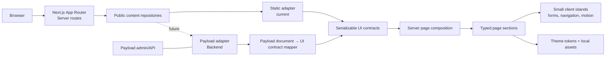
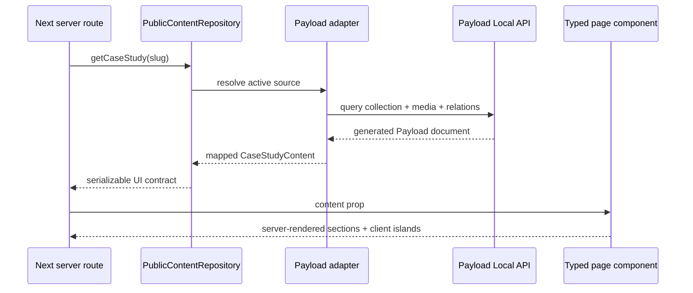

# Architecture frontend et contrat d’intégration Backend

État observé le 29 septembre 2026. Ce document décrit l’architecture réellement présente. Il ne transforme pas encore les contenus statiques en contenus Payload.

## Vue d’ensemble



Principe : un composant visuel ne connaît ni Payload, ni une collection, ni une requête HTTP. Une route serveur demande un contrat UI au repository, puis transmet des données sérialisables à la page et à ses sections. Le futur Backend remplace la source statique derrière cette frontière sans réécrire les composants.

## Arborescence actuelle

```text
src/
├── app/
│   ├── (frontend)/
│   │   ├── layout.tsx                    shell public, providers, header/footer
│   │   ├── page.tsx                      accueil
│   │   ├── contact/page.tsx              contact
│   │   ├── thank-you/page.tsx            confirmation locale
│   │   ├── [slug]/page.tsx               cas Astrolab + fallback pages Payload
│   │   ├── policies/[slug]/page.tsx      documents légaux
│   │   └── not-found.tsx                 404
│   └── (payload)/                         admin et API Payload, séparés
├── components/
│   ├── layout/                            SiteHeader, SiteFooter, SmoothScroll
│   ├── sections/
│   │   ├── HomePage/
│   │   │   ├── HomePage.tsx
│   │   │   ├── HomePage.module.css
│   │   │   ├── shared/                    Starfield, ressorts et cycles partagés
│   │   │   └── sections/                  Hero, Framework, Services, Impact, Cases
│   │   ├── ContactPage/
│   │   ├── CaseStudyPage/
│   │   ├── LegalDocument/
│   │   └── NotFoundPage/
│   └── ui/                                AstroButton, SectionHeading + UI template
├── content/
│   ├── contracts/                         modèles UI indépendants du CMS
│   ├── static/                            contenu anglais actuel
│   └── repositories/                      frontière d’accès actuelle
├── design-system/tokens.css               couleurs, fontes, espacements et motion
└── providers/                              thème et providers React

public/assets/                              médias et polices locaux
tests/unit/                                 comportement, motion et responsive
tests/e2e/                                  scénarios navigateur
```

## Composition des routes publiques

```mermaid
flowchart TB
  L[Public RootLayout] --> H[SiteHeader]
  L --> P{Route}
  L --> F[SiteFooter]

  P --> HOME[/]
  HOME --> HP[HomePage]
  HP --> HERO[HeroSection]
  HP --> FRAME[FrameworkSection]
  HP --> SERVICES[ServicesSection]
  HP --> IMPACT[ImpactSection]
  HP --> CASES[CaseStudiesSection]

  P --> CONTACT[/contact]
  CONTACT --> CP[ContactPage]
  CP --> DETAILS[ContactDetails.client]
  CP --> FORM[ContactForm.client]

  P --> THANKS[/thank-you]
  THANKS --> TP[ThankYouPage]

  P --> CASE_ROUTE[/case-study slug]
  CASE_ROUTE --> CSP[CaseStudyPage]
  CSP --> MOTION[CaseMotion.client]
  CSP --> CSECTION[CaseSection]
  CSP --> RICH[CaseRichText]

  P --> POLICY[/policies/slug]
  POLICY --> LEGAL[LegalDocument]
  LEGAL --> REVEAL[LegalReveal.client]

  P --> NOTFOUND[404]
  NOTFOUND --> NFP[NotFoundPage]
```

## Routes, composants et données attendues

| Route | Repository actuel | Contrat UI | Composition principale | Source Backend proposée |
| --- | --- | --- | --- | --- |
| Toutes | `getSiteContent()` | navigation, réseaux sociaux, bureaux, CTA footer | `RootLayout`, `SiteHeader`, `SiteFooter` | Global `site-settings` |
| `/` | `getHomeContent()` | `HomeContent` | `HomePage` et ses cinq sections | Global `home-page` + relations vers cas |
| `/contact` | `getContactPage()` | `ContactPageContent` | `ContactPage`, détails, formulaire simulé | Global `contact-page` |
| `/thank-you` | `getThankYouPage()` | `ThankYouPageContent` | `ThankYouPage` | Global `thank-you-page` |
| Quatre slugs de cas | `getCaseStudy(slug)` | `CaseStudyContent` | `CaseStudyPage`, sections et projets associés | Collection `case-studies` |
| `/policies/:slug` | `getLegalDocument(slug)` | `LegalDocumentContent` | `LegalDocument` | Collection `legal-documents` |
| 404 | fixture locale | `NotFoundPageContent` | `NotFoundPage` | Global optionnel `not-found-page` |

Les routes historiques `/posts`, `/search` et le fallback Payload de `/[slug]` appartiennent encore au template. Elles ne doivent pas être confondues avec les pages Astrolab lors du raccordement Backend.

## Contrats nécessaires au Backend

### `site-settings`

- `navigation[]`: libellé, URL, ordre et visibilité ;
- `socialLinks[]`: libellé et URL ;
- `offices[]`: pays, drapeau/media, téléphone et adresse ;
- `footerCta`: label, titre et description.

### `home-page`

- `hero`: eyebrow et description ;
- `framework[]`, `services[]`, `impact[]`: titre et description ;
- `cases[]`: relation au cas, image, tags desktop/mobile et options de mise en forme.

### `case-studies`

- identité : `slug`, titre, SEO ;
- hero : media avec `src`, `alt`, largeur et hauteur ;
- overview et marques typographiques ;
- facts et variantes de label mobile ;
- sections ordonnées, blocs de texte/liste et médias ;
- relations `related` vers les autres cas.

### Pages secondaires

- Contact : eyebrow, lignes du titre, garanties, email, liens sociaux et titre du formulaire ;
- Confirmation : titre, corps, CTA et media de fond ;
- Documents légaux : slug, SEO, date, introduction, sections, paragraphes, listes, liens et emphases.

## Interface de repository cible

La version Backend devrait devenir asynchrone dès sa frontière, tout en conservant les contrats UI actuels :

```ts
export interface PublicContentRepository {
  getSiteContent(): Promise<SiteContent>
  getHomeContent(): Promise<HomeContent>
  getContactPage(): Promise<ContactPageContent>
  getThankYouPage(): Promise<ThankYouPageContent>
  getCaseStudy(slug: string): Promise<CaseStudyContent | null>
  getLegalDocument(slug: string): Promise<LegalDocumentContent | null>
}
```

Un mapper dédié convertit les types générés par Payload vers ces contrats. Les composants ne doivent pas importer les types de collections Payload. Les champs de motion, variantes responsive et dimensions des médias font partie du contrat de rendu et ne doivent pas être supprimés par le mapper.

## Séquence d’intégration Backend



## Responsabilités et règles de modification

- Backend : collections, globals, permissions, validation et mapper Payload → contrats UI.
- Frontend : contrats UI, composition des pages, sections, tokens, responsive et motion.
- Partagé : noms de champs, nullabilité, ordre, relations, dimensions des médias et SEO.
- Les composants client reçoivent seulement les données nécessaires à l’interaction.
- Les médias doivent toujours fournir `alt`, largeur, hauteur et point de cadrage lorsque nécessaire.
- Une évolution de collection commence par le contrat UI et le mapper ; elle ne doit pas déclencher un accès direct à Payload depuis une section.
- Le formulaire reste une simulation locale tant qu’un endpoint et ses règles de sécurité ne sont pas explicitement conçus.

## Point architectural à traiter avant le raccordement

`src/app/(frontend)/[slug]/page.tsx` mélange actuellement les quatre cas statiques et le fallback générique Payload. Le comportement fonctionne, mais augmente le couplage et rend l’analyse de bundle plus difficile. Avant l’intégration CMS, choisir explicitement l’une de ces options :

1. collection `case-studies` résolue par ce seul segment dynamique, avec le fallback Pages déplacé ; ou
2. préfixe dédié `/case-studies/[slug]` avec redirects conservant les URL publiques actuelles ; ou
3. résolution unifiée dans le repository, sans importer les composants du template dans le chemin Astrolab.

La troisième option préserve le mieux les URL actuelles avec le moins de changements visibles.
